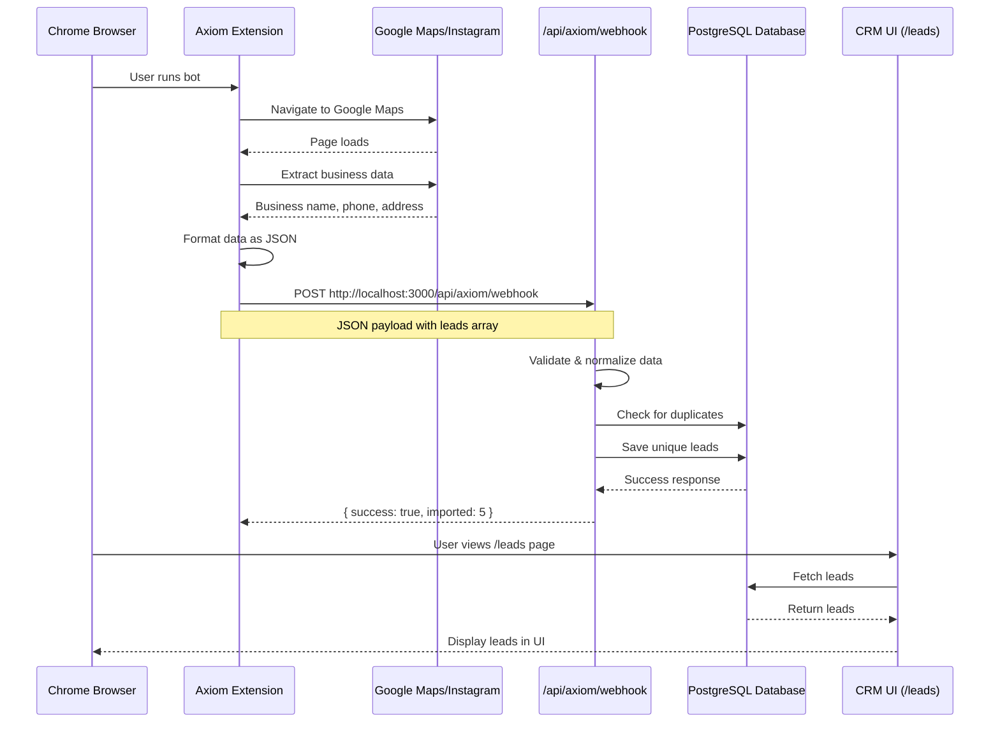
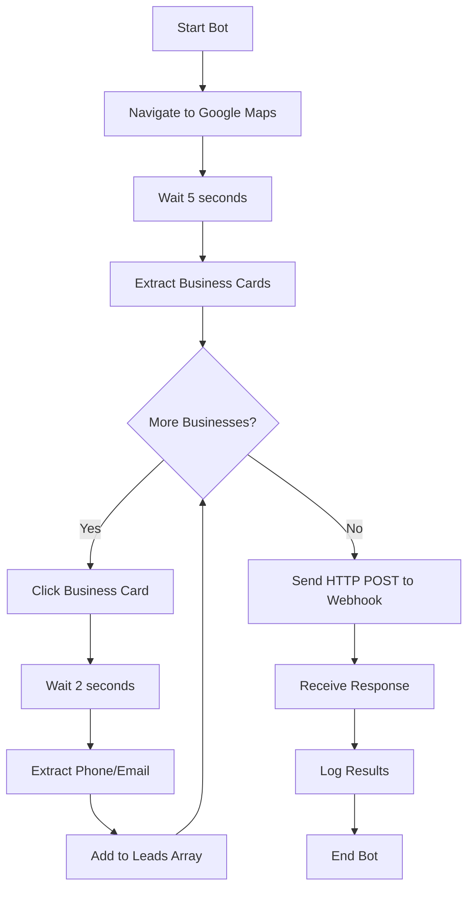

# Axiom Extension to App Connection Flow

## Overview

The Axiom.ai browser extension runs in your Chrome browser and sends scraped data directly to your Next.js app via HTTP POST requests to the webhook endpoint. This document explains the complete data flow, technical architecture, and provides practical examples for configuring Axiom bots.

## Data Flow Diagram



## Complete Data Flow Process

### Step 1: Axiom Extension Runs in Browser

- The Axiom.ai extension is installed in Chrome
- When you create and run a bot, it executes **inside your browser**
- It can see and interact with web pages just like you would manually
- No server-side code required - everything runs client-side

### Step 2: Bot Scrapes Data

The bot performs actions:
1. Navigates to a website (e.g., Google Maps)
2. Waits for page to load
3. Clicks on elements or scrolls
4. Extracts data (business name, phone, address)
5. Stores data in variables

### Step 3: Bot Sends HTTP Request

The bot uses an **HTTP Request** step to send data to your app:

**Endpoint**: `http://localhost:3000/api/axiom/webhook` (local) or `https://your-domain.com/api/axiom/webhook` (production)

**Method**: POST

**Headers**:
```
Content-Type: application/json
```

**Body** (JSON):
```json
{
  "botId": "google-maps-scraper",
  "status": "completed",
  "type": "lead-import",
  "data": {
    "leads": [
      {
        "name": "Fitness Center Lagos",
        "phone": "08012345678",
        "address": "123 Victoria Island",
        "city": "LAGOS",
        "category": "GYM"
      }
    ],
    "source": "Axiom.ai - Google Maps"
  }
}
```

### Step 4: Webhook Receives Request

The webhook endpoint at `app/api/axiom/webhook/route.ts`:

1. **Receives** the POST request
2. **Parses** the JSON payload
3. **Validates** the data (checks required fields, formats)
4. **Normalizes** phone numbers (converts to Nigerian format: 234...)
5. **Deduplicates** leads (checks if already exists in database)
6. **Saves** unique leads to PostgreSQL database
7. **Returns** response with import statistics

### Step 5: Data Appears in CRM

Once saved to the database:
- Leads appear in `/leads` page
- You can view, verify, and message them
- They're ready for your sales process

## Technical Architecture

### Connection Method

**HTTP POST Request**: The extension makes a standard HTTP request from the browser to your server. This works because:
- Your server runs on `localhost:3000` (or your deployed domain)
- The browser can make HTTP requests to any URL
- No special authentication needed (by design for browser extension bots)

### Network Flow

```
Browser (Axiom Extension)
    ↓
HTTP POST Request
    ↓
Your Next.js Server (localhost:3000)
    ↓
/api/axiom/webhook route handler
    ↓
Prisma ORM
    ↓
PostgreSQL Database
```

### Why This Works

1. **Browser Extension**: Runs in your browser, can access web pages
2. **HTTP Requests**: Standard web protocol, works from browser to server
3. **No API Key Needed**: Browser extensions can call your local server directly
4. **Real-time**: Data flows immediately from scraping to database

## Webhook Payload Structure

### Supported Webhook Types

The webhook supports multiple types of data:

1. **lead-import**: Import leads from scraping
2. **payment-verification**: Update payment status
3. **order-sync**: Sync order status from supplier portals
4. **inventory-sync**: Sync inventory/pricing data (placeholder)
5. **ui-test**: Test UI interactions

### Lead Import Payload

```json
{
  "botId": "google-maps-scraper-lagos-gyms",
  "status": "completed",
  "type": "lead-import",
  "timestamp": "2026-01-27T10:30:00Z",
  "data": {
    "leads": [
      {
        "name": "Fitness Center Lagos",
        "phone": "08012345678",
        "email": "info@fitness.com",
        "address": "123 Victoria Island, Lagos",
        "city": "LAGOS",
        "category": "GYM",
        "source": "Axiom.ai - Google Maps"
      }
    ],
    "source": "Axiom.ai - Google Maps"
  }
}
```

### Validation Rules

- **name**: Required, must not be empty
- **phone**: Optional, but must be valid Nigerian format if provided (10-13 digits)
- **email**: Optional, but must be valid email format if provided
- **city**: Required, must be "LAGOS" or "ABUJA" (uppercase)
- **category**: Required, must be one of: GYM, EVENT_CENTER, CLUB, LOUNGE, OFFICE, SMALL_RETAILER, OTHER
- **At least one of phone or email must be provided**

### Response Format

**Success Response**:
```json
{
  "success": true,
  "type": "lead-import",
  "status": "completed",
  "botId": "google-maps-scraper-lagos-gyms",
  "timestamp": "2026-01-27T10:30:00Z",
  "imported": 10,
  "duplicates": 2,
  "errors": 0
}
```

**Error Response**:
```json
{
  "success": false,
  "error": "Validation failed",
  "details": "Lead 0: Missing required field 'name'; Lead 1: Invalid phone format"
}
```

## Practical Examples: Configuring Axiom Bots

### Example 1: Google Maps Gym Scraper

This example shows how to create a bot that scrapes gym leads from Google Maps in Lagos.

#### Step-by-Step Configuration

**Step 1: Navigate to Google Maps**
- Add step: **"Navigate"**
- URL: `https://www.google.com/maps/search/gym+Lagos+Nigeria`
- Wait: 5 seconds after navigation

**Step 2: Extract Business Listings**
- Add step: **"Extract Data"**
- Selector: Click on a business card in the results
- Extract fields:
  - `name`: Business name
  - `address`: Full address
- Repeat: Select "Extract all matching elements"
- Store in variable: `{{businessCards}}`

**Step 3: Loop Through Each Business**
- Add step: **"Loop"**
- Loop over: `{{businessCards}}`
- Inside loop:
  1. **Click**: Click on the business card to open details panel
  2. **Wait**: 2 seconds for details to load
  3. **Extract**:
     - `phone`: Phone number (if available)
     - `email`: Email address (if available)
     - `website`: Website URL (if available)
  4. **Add to Array**: Store in `{{leads}}` array

**Step 4: Send Data to Webhook**
- Add step: **"HTTP Request"**
- Method: POST
- URL: `http://localhost:3000/api/axiom/webhook`
- Headers:
  ```
  Content-Type: application/json
  ```
- Body (JSON):
  ```json
  {
    "botId": "google-maps-scraper-lagos-gyms",
    "status": "completed",
    "type": "lead-import",
    "data": {
      "leads": {{leads}},
      "source": "Axiom.ai - Google Maps"
    }
  }
  ```
- Note: Replace `{{leads}}` with your array variable

**Step 5: Handle Response**
- Add step: **"Extract Data"** (from HTTP response)
- Extract: `success`, `imported`, `duplicates`
- Add step: **"Log"** to display results

#### Complete Bot Flow Diagram



### Example 2: Instagram Business Page Scraper

This example shows how to scrape business information from Instagram profiles.

#### Step-by-Step Configuration

**Step 1: Navigate to Instagram**
- Add step: **"Navigate"**
- URL: `https://www.instagram.com/explore/tags/lagosgym/`
- Wait: 5 seconds

**Step 2: Extract Profile Links**
- Add step: **"Extract Data"**
- Selector: Click on a profile link
- Extract: `profileUrl`
- Repeat: Extract all matching elements
- Store in: `{{profiles}}`

**Step 3: Loop Through Profiles**
- Add step: **"Loop"**
- Loop over: `{{profiles}}`
- Inside loop:
  1. **Navigate**: Go to `{{loop_item.profileUrl}}`
  2. **Wait**: 3 seconds
  3. **Extract**:
     - `name`: Profile name
     - `bio`: Bio text (may contain phone/WhatsApp)
     - `phone`: Extract phone from bio using regex
     - `location`: Location from bio
  4. **Add to Array**: Store in `{{leads}}`

**Step 4: Send to Webhook**
- Add step: **"HTTP Request"**
- Method: POST
- URL: `http://localhost:3000/api/axiom/webhook`
- Body:
  ```json
  {
    "botId": "instagram-scraper-lagos-gyms",
    "status": "completed",
    "type": "lead-import",
    "data": {
      "leads": {{leads}},
      "source": "Axiom.ai - Instagram"
    }
  }
  ```

### Example 3: Business Directory Scraper (BusinessList.ng)

This example shows how to scrape from Nigerian business directories.

#### Step-by-Step Configuration

**Step 1: Navigate to Directory**
- Add step: **"Navigate"**
- URL: `https://businesslist.com.ng/search?q=gym&location=Lagos`
- Wait: 5 seconds

**Step 2: Extract Business Listings**
- Add step: **"Extract Data"**
- Selector: Business listing card
- Extract:
  - `name`: Business name
  - `address`: Address
  - `phone`: Phone number
  - `email`: Email (if visible)
- Repeat: Extract all on page
- Store in: `{{leads}}`

**Step 3: Handle Pagination (Optional)**
- Add step: **"If"** condition
- Condition: Check if "Next" button exists
- If true:
  1. Click "Next" button
  2. Wait 3 seconds
  3. Go to Step 2

**Step 4: Send to Webhook**
- Add step: **"HTTP Request"**
- Method: POST
- URL: `http://localhost:3000/api/axiom/webhook`
- Body:
  ```json
  {
    "botId": "businesslist-scraper-lagos-gyms",
    "status": "completed",
    "type": "lead-import",
    "data": {
      "leads": {{leads}},
      "source": "Axiom.ai - BusinessList.ng"
    }
  }
  ```

### Example 4: Batch Processing with Progress Updates

This example shows how to send progress updates during long-running scrapes.

#### Configuration

**Step 1-3**: Same as Example 1 (Navigate, Extract, Loop)

**Step 4: Send Progress Update**
- Add step: **"HTTP Request"** (inside loop, every 5 items)
- Method: POST
- URL: `http://localhost:3000/api/axiom/webhook`
- Body:
  ```json
  {
    "botId": "google-maps-scraper-lagos-gyms",
    "status": "progress",
    "type": "lead-import",
    "data": {
      "leads": {{currentBatch}},
      "source": "Axiom.ai - Google Maps",
      "progress": "Processing batch 1 of 5"
    }
  }
  ```

**Step 5: Send Final Batch**
- After loop completes, send final batch with `"status": "completed"`

## Data Processing Details

### Phone Number Normalization

The webhook automatically normalizes phone numbers to Nigerian format:

- Input: `08012345678` → Output: `2348012345678`
- Input: `+234 801 234 5678` → Output: `2348012345678`
- Input: `2348012345678` → Output: `2348012345678` (unchanged)

### Deduplication Logic

The system deduplicates leads based on:
1. **Phone number** (primary): If phone matches, lead is duplicate
2. **Email** (secondary): If no phone, email is used for deduplication
3. **Name + City**: Additional check for exact matches

### Lead Status Flow

```
SCRAPED → UNVERIFIED → VERIFIED → MESSAGED → INTERESTED → CUSTOMER
```

When imported from Axiom, leads start with status: `SCRAPED`

## Local vs Production

### Local Development

- **URL**: `http://localhost:3000/api/axiom/webhook`
- Works when `npm run dev` is running
- Only accessible from your computer
- Use for testing and development

### Production Deployment

- **URL**: `https://your-domain.com/api/axiom/webhook`
- Works from any browser
- Accessible from anywhere
- Use for live scraping operations

**Important**: Update the URL in your Axiom bot configuration when deploying to production.

## Troubleshooting

### Bot Can't Connect

**Problem**: "Connection refused" or timeout

**Solutions**:
- Make sure `npm run dev` is running (for local)
- Check URL is correct: `http://localhost:3000/api/axiom/webhook`
- Verify server is accessible (try opening `http://localhost:3000` in browser)
- For production, verify domain is correct and SSL certificate is valid

### Data Not Appearing

**Problem**: Bot runs but leads don't appear in CRM

**Solutions**:
- Check webhook response in Axiom (should show `"success": true`)
- Check server logs for errors
- Verify database connection
- Check `/leads` page filters (may be filtered out)
- Verify lead data format matches validation rules

### Validation Errors

**Problem**: Webhook returns validation errors

**Common Issues**:
- Missing required field `name`
- Invalid `city` (must be "LAGOS" or "ABUJA" in uppercase)
- Invalid `category` (must match CustomerType enum)
- Missing both phone and email (at least one required)
- Invalid phone format (must be 10-13 digits)

**Solution**: Review error details in webhook response and fix data format in bot

### Duplicate Leads

**Problem**: All leads marked as duplicates

**Solutions**:
- Check if leads already exist in database
- Verify phone number normalization is working
- Check deduplication logic in webhook code

## Best Practices

### 1. Rate Limiting

- Add delays between requests (2-5 seconds)
- Don't scrape too aggressively
- Respect website terms of service

### 2. Error Handling

- Add error handling steps in Axiom bots
- Log errors for debugging
- Handle missing data gracefully

### 3. Data Quality

- Validate data before sending to webhook
- Clean phone numbers in bot (remove spaces, dashes)
- Normalize city names (convert to uppercase)

### 4. Testing

- Test with small batches first (5-10 leads)
- Verify data appears in CRM
- Check for duplicates
- Test error scenarios

### 5. Monitoring

- Monitor webhook response times
- Track import success rates
- Log bot execution results
- Review duplicate rates

## Advanced Features

### Custom Webhook Types

You can extend the webhook to handle custom data types:

1. Add new type to `AxiomWebhookPayload` interface
2. Add handler function (e.g., `handleCustomType`)
3. Add case in switch statement
4. Update bot to send new type

### Batch Processing

For large scrapes, send data in batches:

```json
{
  "status": "progress",
  "type": "lead-import",
  "data": {
    "leads": [...],
    "batch": 1,
    "totalBatches": 5
  }
}
```

### Error Recovery

Implement retry logic in bots:

1. Check webhook response
2. If error, wait and retry
3. Log failed items for manual review

## Summary

**Simple Answer**: The Axiom extension runs in your browser, scrapes websites, and sends the data to your app via HTTP POST requests. Your app receives it, validates it, and saves it to the database. Then it appears in your CRM.

**Flow**: Browser Extension → HTTP POST → Webhook Endpoint → Database → CRM UI

**Key Points**:
1. **No Server-Side Scraping**: Axiom runs in browser, not on your server
2. **Direct HTTP Connection**: Browser → Your Server (simple HTTP POST)
3. **Real-time Import**: Data flows immediately from scraping to database
4. **No Authentication Required**: Browser extension bots work without API keys
5. **Standard Web Protocol**: Uses normal HTTP requests (nothing special)

## Next Steps

1. Create your first Axiom bot using Example 1
2. Test with a small batch (5-10 leads)
3. Verify data appears in CRM
4. Scale up to larger batches
5. Create bots for other sources (Instagram, directories)
6. Monitor and optimize scraping performance
