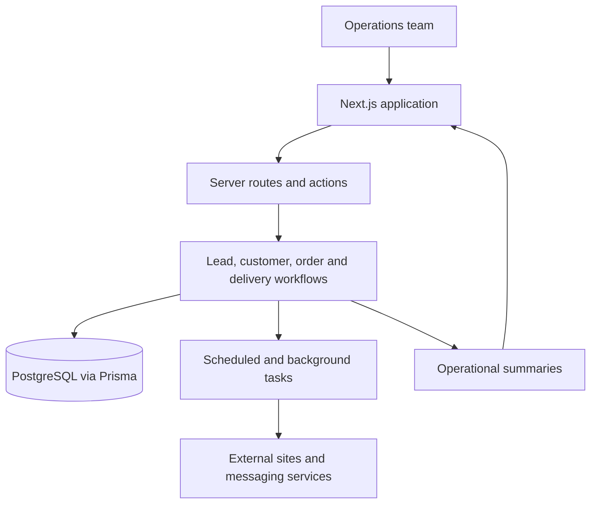

# Architecture

This application organizes lead-to-delivery workflows for a beverage distribution operation. It is a Next.js application backed by PostgreSQL and Prisma, with supporting automation and communication integrations.

## Core workflow

1. Leads are captured or imported and reviewed.
2. Qualified leads become customer records.
3. Orders are created and tracked through operational states.
4. Payments are recorded and reconciled by staff against their source records.
5. Delivery planning supports fulfillment and follow-up.
6. Scheduled tasks assist with reminders and operational housekeeping.

## Design decisions

- Keep lead, customer, order, payment, and delivery concerns separated in domain workflows.
- Treat payment records as operational records unless independently reconciled against a payment provider or bank source.
- Treat scraping and messaging as controlled integrations with explicit policy, consent, and rate-limit requirements.
- Keep scheduled jobs authenticated and observable; jobs must fail closed when required secrets are missing.

## Production-readiness considerations

Verify authentication and authorization on every server endpoint, validate inputs, secure cron endpoints, apply rate limits, protect messaging sessions, respect target-site terms and privacy law, and maintain audit trails for order/payment changes. Add structured logs and alerting for failed jobs and integration errors.

This diagram is a conceptual map of the application. Check the code before assuming every integration runs in production.
